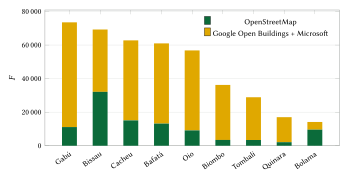
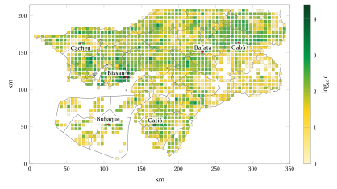
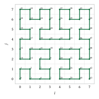
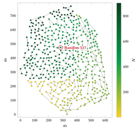
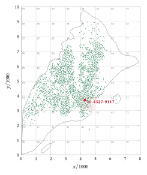
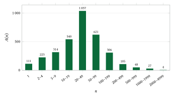
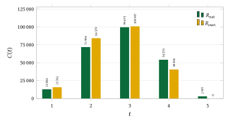

# Introduction

An address is a piece of public infrastructure. It lets a household receive a letter, a parcel or a visitor; it lets an ambulance reach a patient; it lets a utility, a bank or a ministry refer to the same dwelling without describing it. The Universal Postal Union estimates that a large share of the world's population lives without a usable address, and it treats addressing as a precondition for postal service, financial inclusion and civil registration [@upu2012]. The World Bank's review of street addressing in African cities reached a similar conclusion, adding that addressing programmes fail when residents do not adopt them [@farvacque2005].

Guinea-Bissau is a clear case. Its postcode format exists on paper, but only two codes are attested, both in Bissau [@upu-gw2005]; doors are not numbered outside a few central streets; and the two most common ways of describing a home are the name of the bairro or tabanca and a landmark. A delivery depends on a telephone call, an ambulance crew depends on local knowledge, and a family abroad cannot write a destination that a courier can check.

This paper describes and evaluates an addressing model built for this setting. Its unit is the compound, the *morança* or walled *quintal* where a family lives. Its code is a place word that people already say, followed by a short number: *Bandim 537*. Its design goals, in order, are that people remember the code and obtain it without effort; that the spoken code is unique in the whole country on its own; that it leads to the compound's gate; that it works offline; and that no code ever changes or is reused.

Our contributions are the following.

1. A code form, and the arithmetic behind it, in which every place that shares a name draws its numbers from one national range for that name, divided into frozen blocks. The spoken form thus needs no sector, town or position to be decoded (Section 4).
2. A complete specification of every step, from building footprints to compounds, places, plate names, name keys, blocks, numbering, check digit and spot codes, with each formula and a worked example on a real code (Section 4).
3. An open implementation: a reference engine, conformance vectors, the full registry of 241,673 codes, and a server that any institution can deploy to answer queries and, if designated, issue codes by the same rules (Section 5).
4. An evaluation on the full registry of uniqueness, code length, coverage, error detection and decoding accuracy (Section 6), and a record of the alternative designs we measured and rejected (Section 7).
5. Estimates, with stated assumptions and sensitivity ranges, of the model's value for citizens, for logistics and commerce, for emergency services and for government planning (Sections 8 to 11).

Section 2 reviews the country's existing systems and the international literature, and Section 3 the data. Section 12 addresses privacy, safety and governance, Section 13 the limitations and future work, and Section 14 concludes.

# Background and related work

## Guinea-Bissau

Guinea-Bissau covers about 36,000 km² on the Atlantic coast of West Africa, between Senegal and Guinea. The fourth General Population and Housing Census, conducted by the Instituto Nacional de Estatística (INE) in June 2026, had counted 2,213,173 people, more than 600,000 dwellings and about 301,000 households by 22 June, according to preliminary figures [@lusa2026]. The 2009 census counted 1,520,830 people, which implies average growth of about 2.2 % a year. The country is divided into eight regions and the Setor Autónomo de Bissau, and the regions into 38 sectors [@wiki-sectors; @pcgn2024]. The capital lies on the Ilha de Bissau, joined to the mainland by road. Offshore, the Bijagós archipelago comprises some 88 islands and islets, many of them reachable only by boat.

Kriol is the lingua franca, spoken by about 90 % of the population in the 2009 census; Portuguese, the official language, by 27 %; Fula, Balanta, Mandinka, Papel and Manjaco are the largest first languages, and French is spoken by about 5 % [@wiki-languages]. Adult literacy was 63.9 % in 2022 [@fred-literacy]: 77.3 % for men and 52.2 % for women, a gap of 25.2 percentage points [@wb-gender]. An address that must be read, spelled or written in Portuguese therefore excludes a large part of the population; one that consists of a familiar place and a spoken number excludes very few.

## Existing postal, address and land systems

We reviewed the country's postal, address and land systems between 18 and 20 October 2026. The full record is in `docs/existing-systems.md`; the main findings are as follows.

**Postcodes.** The UPU addressing sheet for Guinea-Bissau, dated March 2005, specifies four digits to the left of the locality name, with the examples `1000 BISSAU` and `1011 BISSAU`, the latter for the Direcção Geral dos Correios [@upu-gw2005]. We found no other code, no directory and no lookup service. The domain of the postal operator, Correios da Guiné-Bissau [@correios-wiki], did not resolve, and GeoNames, the main open postcode dataset, has no file for the country [@geonames-zip]. Mail is delivered to post-office boxes or collected at the counter.

**Doors and streets.** We found no street-naming, house-numbering or digital-address programme in news or government sources from 2024 to 2026. In OpenStreetMap, which records 99,131 building outlines in the country, two buildings carry a house number and eight a street name [@geofabrik-gw]. Street names of the Câmara Municipal de Bissau are in use in Bissau Velho, the Praça and the central avenues; whether the doors there are numbered under an official plan could not be verified.

**Census and land.** The 2026 census was announced with georeferencing of dwellings [@forbes-census]; its enumeration maps are not public but are the official dataset closest to an address register. The Lei da Terra (Law 5/98) vests land in the State, recognises customary use rights and grants private use by concession [@leiterra1998]; the cadastre of the Direcção Geral de Geografia e Cadastro (DGGC) is partial and mostly on paper. Law 14/2026 on land-use and urban planning enters into force on 22 October 2026 and creates a planning framework rather than addresses [@geocracia2026]. Survey plans use the national *Bissau* datum (EPSG:2095) or WGS 84 [@epsg2095], which differ by tens of metres.

**Data protection.** We found no national personal-data law or authority. Guinea-Bissau is bound in principle by the ECOWAS Supplementary Act A/SA.1/01/10 on personal data protection [@ecowas2010], and a bill on electronic transactions was put to public consultation in May 2026 [@odemocrata2026].

## International practice

The UPU's standard S42 defines the components of postal addresses and the templates by which each country renders them [@upu-s42]. It is a format standard: it presupposes that streets, numbers and postcodes exist. Where they do not, the UPU and the World Bank describe two families of response [@upu2012; @farvacque2005]. The first is conventional street addressing: naming streets, numbering doors along them and maintaining a register. In the 21 African cities reviewed by the World Bank, only 8 % of streets were named before addressing began, and the average cost was about US\$5.7 per doorway at 2005 prices [@farvacque2005]. The second is a grid or coordinate code, computed from latitude and longitude and requiring no fieldwork.

## Other code systems and why they do not fit

Grid codes such as Open Location Code (Plus Codes) are open, global and computable offline [@olc]. A code such as `7C36VC23+VX4` names a square of about 3 m, not a home, and mixes letters with digits. Spoken in Guinea-Bissau, each letter must be named with its Portuguese letter name, which most Kriol speakers do not use; and two members of a household standing at different corners of a yard obtain different codes. Digits-only national codes avoid letters but offer nothing to anchor them in memory. Sector-and-number codes are short to say, but in sectors with up to 14,700 compounds the numbers run to five digits, and many people do not use sector names in daily life. Street-and-number addresses require named streets, which do not exist in most of the country. The comparison is summarised below.

| Form | Example | Spoken | Remembered | Unique alone | Requires |
|:---------------|:----------------|:-------------|:-------------|:---------|:--------------|
| Grid code | 7C36VC23+VX4 | letters, a plus sign | hard | yes | nothing |
| Sector and number | Bissau 48213 | easy | moderate | yes | a register |
| National digits | 00228 00537 | easy | hard | yes | a register |
| Street and door number | Rua 12, n.º 7 | easy | easy | with the town | named streets, a register |
| **Place word and number** | **Bandim 537** | **easy** | **easy** | **yes** | **a register** |

: Code forms compared for use in Guinea-Bissau.

Plus Codes nevertheless remain useful as a universal coordinate reference, and every registry record carries one. The model described here does not replace them; it adds the layer that people say.

# Data and sources

**Building footprints.** The model starts from 419,593 building footprints after removing outlines under 6 m². Of these, 99,131 are from OpenStreetMap [@geofabrik-gw] and 320,462 are machine-learned footprints from Google Open Buildings [@sirko2021] and Microsoft [@microsoft-buildings], which we obtained through the Overture Maps buildings theme [@overture], keeping only footprints that do not overlap an OpenStreetMap outline. Figure 1 shows their distribution by region: OpenStreetMap is the larger source only in the Bolama-Bijagós region, where volunteers have traced the islands in detail, and machine-learned footprints dominate elsewhere. Their height attribute is a rendering placeholder, so the model never uses it.

{width=82%}

**Boundaries and islands.** The 39 sectors (38 *setores* and the Setor Autónomo de Bissau) come from OpenStreetMap's administrative boundaries, cross-checked against geoBoundaries and the PCGN list [@pcgn2024], and were frozen on 18 October 2026. The 189 island and islet polygons come from the same extract.

**National border.** The national border is OpenStreetMap's administrative boundary of Guinea-Bissau at admin_level 2 (relation 192776, `ISO3166-1=GW`), ODbL. It decides which buildings belong to the country: a footprint, a compound or an entrance counts only when it lies inside that border or within 300 m of it, whatever a sector outline or another source of outlines (geoBoundaries, GADM) says, because outlines from different sources can spill over a border. The 300 m allow for footprints drawn across the line and for the precision of the line itself. Every code in the registry has its entrance inside the border or within that distance.

**Places.** Place points come from OpenStreetMap (bairros, towns, villages, hamlets, named moranças) and then from GeoNames. A GeoNames locality is kept only when no OpenStreetMap place lies within 400 m and none of the same name within 1.5 km. The place table holds 4,221 places and 39 sector words.

**Enclosures and gates.** Walls, fences, hedges, farmyard outlines (`landuse=farmyard`, 782 in the extract) and gates are taken from OpenStreetMap.

**Statistics.** Population, households, languages and literacy are from the census and international statistics cited in Section 2. Every count in this paper that concerns codes is computed from the published registry, and the scripts that compute the figures are in the repository (`tools/paper_figures.py`).

# The model

## Design principles

The model follows nine principles, in order of priority.

1. **Memorable and effortless.** A code is a place word people already use and a short number; obtaining it takes one tap.
2. **Unique on its own.** The spoken code identifies one home in the country with no town, sector, island or position.
3. **The compound and its gate.** The unit is the morança or quintal; its structures are sub-units; navigation ends at the gate.
4. **Official first.** Where a government address exists, it is shown first, as the government writes it.
5. **Offline.** Spot codes, place words and check digits are computable without a network.
6. **Stable.** A code never moves and is never reused; regrouping, renaming and new boundaries never change an issued code.
7. **Places, never people.** No name or detail of a resident is stored.
8. **Open and transferable.** Engine, registry and rules are open and designed to be handed to the State.
9. **National.** The model and its engine are specific to Guinea-Bissau.

## The forms of a code

A code has three equivalent forms. The **remembered form** $P\;N$ is the place's plate name $P$ followed by the number $N \in \{1, \dots, 99\,999\}$; it is what people say, type and write, and it is also the **written form** used on plates and parcels. The **machine form** is

$$
\underbrace{SS}_{\text{sector}}\;\text{-}\;\underbrace{PPP}_{\text{place}}\;\text{-}\;\underbrace{NNNNN}_{\text{number}}\;\text{-}\;c,
\qquad c = \operatorname{Damm}\!\left(F \,\|\, NNNNN\right),
\tag{1}
$$
where $SS$ is the two-digit sector number, $PPP$ the place's three-digit index within it, $NNNNN$ the number padded to five digits, $F$ the five-digit national number of the place's name (Section 4.7), $\|$ concatenation and $\operatorname{Damm}$ the check function of Section 4.12. A structure inside a compound adds a suffix (`Bandim 537.2`, `10-022-00537.2-c`). Only the machine form carries the check digit: people never see it. A **spot code** (Section 4.13) names any point without a compound.

| Form | Example | Used by |
|:--|:--|:--|
| Remembered and written | Bandim 537 | people: said, typed, painted on the gate |
| Machine | 10-022-00537-4 | systems, QR codes, partners |
| Structure | Bandim 537.2 | a second building of the compound |
| Spot | 10-4327-9117 | any point without a compound |

: The forms of one code.

## Sectors

Each of the 39 sectors has a two-digit number whose first digit is its region (1 Bissau, 2 Bafatá, 3 Bolama, 4 Biombo, 5 Cacheu, 6 Gabú, 7 Oio, 8 Quinara, 9 Tombali), a three-letter key, and its own spot grid (Section 4.13). Bissau is sector 10; numbers 11 to 19 are reserved should the city be divided into districts. A point $\mathbf{p}$ belongs to the sector whose outline contains it, by ray casting with holes excluded:

$$
s(\mathbf{p}) =
\begin{cases}
\sigma & \text{if } \mathbf{p} \in \Omega_\sigma \text{ and } \delta_B(\mathbf{p}) \le 300\ \text{m}, \\
\varnothing & \text{otherwise},
\end{cases}
\tag{2}
$$
where $\Omega_\sigma$ is the outline of sector $\sigma$ and $\delta_B(\mathbf{p})$ the distance from $\mathbf{p}$ to the national border $B$, zero inside it. Points at sea or abroad have no sector. **The border decides:** a point more than 300 m outside the national border has no sector even where a sector outline holds it, so no building in a neighbouring country ever receives a code. The engine carries $B$ simplified by Douglas–Peucker at 50 m, whose largest distance from the true line is 50.2 m, and accepts a point at most 248 m outside it, so no accepted point lies more than 300 m outside the true border. Grouping applies the same test to every footprint and compound before any number is given, and the registry server applies it to every new code and every moved entrance. Figure 2 shows the outlines and the density of compounds.

{width=100%}

| Region | Sectors | Compounds |
|:----------------------|:----------------------------------------------------|--------------:|
| Setor Autónomo de Bissau | 10 Bissau | 43,850 |
| Gabú | 61 Boé, 62 Gabú, 63 Pirada, 64 Pitche, 65 Sonaco | 43,414 |
| Cacheu | 51 Bigene, 52 Bula, 53 Cacheu, 54 Caió, 55 Canchungo, 56 São Domingos | 35,431 |
| Bafatá | 21 Bafatá, 22 Bambadinca, 23 Contuboel, 24 Galomaro, 25 Gã-Mamudo, 26 Xitole | 34,427 |
| Oio | 71 Bissorã, 72 Farim, 73 Mansabá, 74 Mansoa, 75 Nhacra | 29,493 |
| Biombo | 41 Prábis, 42 Quinhamel, 43 Safim | 21,852 |
| Tombali | 91 Bedanda, 92 Cacine, 93 Catió, 94 Komo, 95 Quebo | 16,101 |
| Quinara | 81 Buba, 82 Empada, 83 Fulacunda, 84 Tite | 9,131 |
| Bolama | 31 Bolama, 32 Bubaque, 33 Caravela, 34 Uno | 7,974 |
| **Total** | **39** | **241,673** |

: Regions, sectors and compounds in the registry.

## Compounds: grouping structures

A family home in Guinea-Bissau is usually several structures. A rural morança has a main house, kitchens, stores and sometimes round houses around a yard; a Bissau quintal is often walled. The footprints reflect this: a quarter are under 33 m² and half are over 116 m², and in Gabú region the median is 41 m², because the Fula and Mandinka compounds of the east consist of many small houses. Numbering buildings would give a family several codes; we therefore group footprints into compounds before any number is assigned.

**Settlement class.** For each footprint, the density $\rho$ of footprints in the 250 m square centred on it (five cells of 50 m in each direction) determines a settlement class:

$$
\rho = \frac{\#\{\text{footprints within } \pm 2 \text{ cells of } 50\ \text{m}\}}{6.25\ \text{ha}},
\qquad
\text{class} =
\begin{cases}
\textit{cidade} & \rho \ge 10\ \text{ha}^{-1},\\
\textit{vila} & 4 \le \rho < 10,\\
\textit{tabanca} & 1 \le \rho < 4,\\
\textit{disperso} & \rho < 1.
\end{cases}
\tag{3}
$$

**Gap between structures.** For footprints $a$ and $b$ with centroids $\mathbf{c}_a, \mathbf{c}_b$ and areas $A_a, A_b$, we approximate the gap between their walls by

$$
g(a, b) = \lVert \mathbf{c}_a - \mathbf{c}_b \rVert - \tfrac{1}{2}\sqrt{A_a} - \tfrac{1}{2}\sqrt{A_b}.
\tag{4}
$$

The rules below are applied in order. Structures are first sorted by sector, latitude, longitude, area and identifier, so that the result never depends on the order in which map data arrives.

| Rule | Condition | Effect |
|:----------|:---------------------------------------------------|:------------------------------|
| Enclosure | centroid inside a mapped wall, fence, hedge, farmyard ($\le 1$ ha), residential plot ($\le 2{,}500$ m²) or institutional site | the enclosure is one compound |
| Annex | $A < 40$ m² and $g \le d_a$ to a structure | joins the nearest structure |
| Houses | both $A \ge 40$ m² and $g \le d_g$ | single-linkage into one compound |
| Cap | a group of more than 12 structures | re-linked with halved distances until every group has at most 12 |

: Grouping rules, applied in order.

| Class | $d_a$ (annex) | $d_g$ (houses) |
|:--|--:|--:|
| cidade | 6 m | 3 m |
| vila | 10 m | 6 m |
| tabanca | 15 m | 12 m |
| disperso | 20 m | 15 m |

: Joining distances by settlement class.

**Result.** The rules yield 241,673 compounds from 419,593 footprints: 144,820 compounds of one structure, 56,535 of two, 21,794 of three and 18,524 of four or more (mean 1.74). Of all footprints, 65.5 % belong to a compound of two or more structures, from 58 % in Bissau to 71 % in Oio; 763 compounds come from mapped enclosures. With about 301,000 households in the census, there are about 1.25 households per compound, consistent with family compounds that house more than one household.

**Validation.** We re-ran the proximity rules with the enclosures that mappers drew hidden and compared the result with those enclosures. Of 159 mapped rural moranças, 58 % are recovered whole and 46 % exactly, and a further 24 % miss only one structure. In 53 walled urban plots only 13 % are recovered whole: inside a Bissau wall the buildings stand far apart, while neighbours across the wall stand close. The rule is deliberately cautious in town, because the two errors are not symmetric: merging two codes later costs nothing (one becomes an alias), whereas splitting a wrong merge would give a family a new code.

## Places and the point-to-place rule

The place word is a Bissau bairro (including the former villages the city has absorbed, which are bairro names today: Plaque, Jal, Bono, Quetene, Cuntum), a town or one of its bairros, a village, a hamlet or a morança cluster. A compound $c$ in sector $s$ on land mass $L$ takes the nearest place of its own sector and land mass within 3 km, and otherwise the sector's own word:

$$
p(c) =
\begin{cases}
\displaystyle\operatorname*{arg\,min}_{q \in \mathcal{P}(s, L)} d(c, q) & \text{if } \displaystyle\min_{q \in \mathcal{P}(s, L)} d(c, q) \le 3\,000\ \text{m},\\[1ex]
\text{the sector word (index 000)} & \text{otherwise,}
\end{cases}
\tag{5}
$$
where $\mathcal{P}(s, L)$ is the set of places of sector $s$ on land mass $L$, $d$ is ground distance in metres, and ties go to the lower index. The Ilha de Bissau counts with the mainland because a road joins them; every other island is its own land mass, so a home on Orango is never numbered in a place on Bubaque.

Of the 4,221 places, 3,336 hold at least one compound. Thirty-seven sectors use their own word for 5,430 compounds that lie more than 3 km from any named place. A disputed or renamed bairro never changes a code: the new name becomes an alias.

## Plate names

The word in a code must be short enough to say together with a number. We call the admissible short form the **plate name**, and require

$$
\operatorname{plate}(w) \iff \bigl|\operatorname{NFC}(w)\bigr| \le 12 \;\wedge\; \bigl|\operatorname{words}(w) \setminus \mathcal{L}\bigr| \le 2 \;\wedge\; w \text{ contains no digit},
\tag{6}
$$
where $|\operatorname{NFC}(w)|$ counts characters in Unicode normal form C (an accented letter counts once), $\operatorname{words}(w)$ are the parts separated by spaces or hyphens, and $\mathcal{L} = \{$de, da, do, das, dos, d, e, o, a, os, as, em, na, no, di, du$\}$ is the set of linking words.

A name that fails Eq. (6) goes through fixed steps: a documented short form already in use; cleaning (brackets, "Bairro de", "Tabanca de", "Morança" and generic words: "Bairro Ajuda II Phase" becomes *Ajuda II*); abbreviation of a saint prefix (*Sto António*); and otherwise selection of the most distinctive run of one or two whole words. Each candidate run $r$ is scored by the mean frequency of its words among all place names in the country,

$$
\operatorname{rarity}(r) = \frac{1}{|\operatorname{words}(r)|} \sum_{u \in \operatorname{words}(r)} f(u),
\tag{7}
$$
where $f(u)$ is the number of place names containing word $u$. The run with the lowest score is taken, with a preference for the end of the name, only if it is ahead of the next by a factor of at least 1.5. Thus "Sinchã Malam Baio" becomes *Malam Baio* and "Missirá Ama Sidi" becomes *Ama Sidi*. Settlement heads (*Sinchã*, *Sare*, *Madina*, *Gã*, *Ponta*, *Ilhéu*) are dropped first and are never a plate name alone. The names of the peoples after whom a tabanca is named (Balanta, Mancanha, Papel, Fula, Beafada) are never dropped automatically, because "Bambadinca Balanta" and "Bambadinca Mancanha" are two villages.

When no short form is clearly right, the place is flagged for the Câmara Municipal in Bissau, or for the sector administration with the *régulos* and the community, with up to three candidates. Of the 3,336 places in use, 2,807 keep their name, 17 are cleaned, 119 are shortened, 37 are sector words and 356 are flagged, 28 of which still exceed the limit. The 21,759 codes in flagged places were issued with the provisional name. The council's choice may change the word once; the official name always remains an alias.

## The name key

Two names that sound or look alike must never be distinguishable only by the listener, so they share a **name key** and, with it, one national number range. The key of a word $w$ is a composition of normalisation steps,

$$
\kappa(w) = \Phi\bigl(\delta(\nu(\epsilon(\pi(\tau(\alpha(w)))))))\bigr) \,\|\, \#\,n(w),
\tag{8}
$$
where $\alpha$ lowers case, reads *ç* as *s* and removes accents; $\tau$ replaces every character other than a–z and 0–9 by a space; $\pi$ removes a leading *Bairro*, *Tabanca*, *Aldeia*, *Povoação* or *Morança* (with a following *de*, *da* or *do*); $\epsilon$ expands the abbreviations *Sto*, *Sta*, a leading *S.* and *N. Sra*; $\nu$ sets aside a trailing numeral I–X or 1–10 as the Roman numeral $n(w)$; $\delta$ removes the small words *de, da, do, dos, das, e, o, a, os, as* when more remains; and $\Phi$ folds spellings of one sound to one letter, as follows. A final *que* becomes *k*; *tch*, *ch* and *sh* become *x*; *ck* and *qu* become *k*; *gu* becomes *g*; *ph* becomes *f*; *nh* becomes *n*; *lh* becomes *l*; *c* before *e* or *i* becomes *s* and any other *c* becomes *k*; *z* becomes *s*, *y* becomes *i*, *w* becomes *u*; *h* is dropped; the Kriol vowel spellings are merged (*e* with *i*, *o* with *u*); and doubled letters are reduced to one. The suffix $\#\,n(w)$ is present only when a numeral was set aside.

Thus *Sintchã Dulo*, *Sinchã Duló* and *Sincha Dulu* share the key `sinxadulu`; *Plack* and *Plaque* share `plak`; *Áfià* and *Hafia* share `afia`; while *Plaque II* (`plak#ii`) is a name of its own. Because a word typed without its cedilla (*Praca* for *Praça*) would otherwise fold *c* to *k*, every name containing *ç* also resolves from its cedilla-free spelling (Section 6.2). The folding errs towards merging on purpose: joining two names costs only a longer range, whereas keeping apart two names that sound alike would give two homes the same spoken code.

Applied to the 4,221 places and 39 sector words, Eq. (8) gives 3,295 name keys, 2,704 of which hold compounds. Of these, 407 names are shared by two or more places in use, over 1,039 places and 92,745 compounds (38 % of the total); 183 names are repeated within a single sector. Missirá has the most places (14), followed by Áfià (13), Madina (12) and Amedalai (11).

## One national range per name

Because a name is said without its town, all places that share a name key draw their numbers from one **national range** $\{1, \dots, 99\,999\}$, divided into one block per place. A number falls in exactly one block, so a name and a number decode to exactly one place.

**Block size.** A place with $n$ compounds at first issue receives the smallest block of the 1–2–5 series that holds four times its compounds:

$$
b(n) = \min\bigl\{x \in \{10, 20, 50, 100, 200, 500, 1\,000, \dots, 50\,000\} : x \ge 4n \bigr\}.
\tag{9}
$$

The factor four follows from the numbering rule of Section 4.9: the first issue uses every second number, so half of the block is consumed by the initial compounds and the numbers between them; the other half is left for the place's growth.

**Block placement.** The places of one name are taken largest first, places awaiting a council's choice of plate name after the others, and each block starts at the name's high-water mark rounded up to a multiple of a power of ten matched to its size:

$$
\begin{aligned}
\operatorname{step}(b) &= 10^{\lfloor \log_{10} b \rfloor},
&
\text{from}_i &= \operatorname{step}(b_i)\left\lceil \frac{H_{i-1}}{\operatorname{step}(b_i)} \right\rceil,\\
\text{to}_i &= \text{from}_i + b_i - 1,
&
H_i &= \text{to}_i + 1,
\end{aligned}
\tag{10}
$$
with $H_0 = 0$. Round starting numbers make the blocks legible: the Bissau bairro of Bandim holds 0–1,999 and the tabanca of Bandim in Catió 2,000–2,199.

**Worked example.** Bandim, a bairro of Bissau (sector 10, place 022), had $n = 452$ compounds at first issue and is the largest place of its name, so $4n = 1\,808$, $b = 2\,000$ and its block is 0–1,999. Fourteen places share the name Missirá; Figure 3 shows how their blocks divide the range. *Missira 101* is in Bissau and *Missirá 5101* in Sonaco; neither needs its sector.

{width=96%}

| Place | Sector | Compounds | Block |
|:--|:--|--:|:--|
| Missira | Bissau | 771 | 0–4,999 |
| Missirá | Sonaco | 81 | 5,000–5,499 |
| Missirá | Gabú | 53 | 5,500–5,999 |
| Missirá | Bafatá | 49 | 6,000–6,199 |
| Missirá | Bissorã | 44 | 6,200–6,399 |
| Missirá | Bambadinca | 30 | 6,400–6,599 |
| … eight more | | 113 | up to 7,249 |

: The blocks of the name Missirá.

**Growth horizon.** At first issue a place uses odd numbers up to $2n - 1$ within a block of at least $4n$, so it can hold four times its initial compounds before it needs a further block. At a constant growth rate $r$, that takes

$$
t = \frac{\ln 4}{\ln (1 + r)} \approx
\begin{cases}
63\ \text{years} & r = 2.2\,\%\ \text{(national average)},\\
35\ \text{years} & r = 4\,\%\ \text{(the fast-growing edges of Bissau)}.
\end{cases}
\tag{11}
$$

**Frozen table.** The block table was frozen at first issue on 20 October 2026. A block is never moved, renumbered or shrunk. A new place with an existing name, or a place whose block fills, receives a further block above the name's high-water mark by Eq. (10).

The largest shared range is Áfià's (13 places, 2,560 compounds), which ends at 15,719. No name approaches 99,999, so no qualifier is needed.

## Numbering within a place: the Hilbert curve

Inside its block, a place's compounds are numbered along a Hilbert curve [@hilbert1891], so that neighbours on the ground receive neighbouring numbers, as house numbers do along a street. Among space-filling curves, the Hilbert curve has the best clustering properties: a compact region of the plane maps to few contiguous runs of the curve [@moon2001].

**The grid.** Each sector has a frame of $10\,000 \times 10\,000$ cells with south-west corner $(\varphi_S, \lambda_W)$, reference latitude $\varphi_r$ and cell size $\Delta$ in metres (1.7 m in Bissau, up to 9.4 m in Gabú). A point $(\varphi, \lambda)$ lies in the cell

$$
x = \operatorname{clip}\!\left(\left\lfloor \frac{(\lambda - \lambda_W)\cos\varphi_r \cdot 111\,320}{\Delta} \right\rfloor\right),
\qquad
y = \operatorname{clip}\!\left(\left\lfloor \frac{(\varphi - \varphi_S) \cdot 110\,574}{\Delta} \right\rfloor\right),
\tag{12}
$$
where $\operatorname{clip}$ limits the result to $0, \dots, 9\,999$ and the constants are metres per degree of longitude at the equator and of latitude.

**The curve.** The Hilbert index $h(x, y)$ on a curve of order 14 ($2^{14} = 16\,384$ cells a side, enclosing the grid) is computed from the most significant bit down. With $h = 0$ and, for $\sigma = 2^{13}, 2^{12}, \dots, 1$,

$$
\begin{aligned}
r_x &= \left\lfloor x / \sigma \right\rfloor \bmod 2,
\qquad
r_y = \left\lfloor y / \sigma \right\rfloor \bmod 2,
\qquad
h \leftarrow h + \sigma^2 \bigl((3 r_x) \oplus r_y\bigr),\\
(x, y) &\leftarrow
\begin{cases}
(y, x) & r_y = 0,\ r_x = 0,\\
(2^{14} - 1 - y,\ 2^{14} - 1 - x) & r_y = 0,\ r_x = 1,\\
(x, y) & r_y = 1,
\end{cases}
\end{aligned}
\tag{13}
$$
where $\oplus$ is bitwise exclusive or. Figure 4 shows the curve of order 3 computed by the reference engine.

{width=52%}

**First issue.** The $n$ compounds of a place with block $[\text{from}, \text{to}]$, sorted by $(h, \text{key})$ where the key is the stable identifier of the compound's main structure, receive

$$
N_k = \text{from} + 1 + 2k, \qquad k = 0, 1, \dots, n - 1.
\tag{14}
$$

The even numbers between neighbours remain free for compounds built later between them.

**Worked example: Bandim 537.** The compound nearest Bandim market has its entrance point at $\varphi = 11.8521485$, $\lambda = -15.5950371$. In Bissau's frame ($\lambda_W = -15.662$, $\varphi_S = 11.795$, $\varphi_r = 11.87$, $\Delta = 1.7$ m), Eq. (12) gives the cell $(4\,291, 3\,717)$ and Eq. (13) the Hilbert index $33\,435\,700$. It is the 269th of Bandim's 452 compounds along the curve ($k = 268$), so Eq. (14) gives $N = 0 + 1 + 2 \cdot 268 = 537$. Figure 5 shows the whole bairro.

{width=76%}

## A new home

A new compound between its Hilbert neighbours $a$ (the issued number just before it along the curve) and $b$ (just after), with indices $h_a < h < h_b$, takes the free number nearest its proportional position $N^{*}$:

$$
\begin{aligned}
N^{*} &= a + \max\Bigl(1,\ \min\Bigl(b - a - 1,\ \operatorname{round}\Bigl(\frac{h - h_a}{h_b - h_a}\,(b - a)\Bigr)\Bigr)\Bigr),\\
N_{\text{new}} &= \operatorname*{arg\,min}_{a < m < b,\ m\ \text{free}} \lvert m - N^{*} \rvert,
\end{aligned}
\tag{15}
$$

If no number is free between $a$ and $b$, or the compound comes after the last one, it takes the place's highest number plus one, if that is still in the block; otherwise the next block of the place, and if all are full a continuation block sized by Eq. (9) and placed by Eq. (10). A retired number is never reused.

## Decoding without context

To decode a remembered form, the trailing digits are the number $N$ and the words before them the name $P$. The name key gives the national range, and the number gives the one block that holds it:

$$
\operatorname{decode}(P, N) = \bigl\{\, q : \kappa(P) \in K(q) \;\wedge\; N \in B(q) \,\bigr\},
\tag{16}
$$
where $K(q)$ is the set of keys of place $q$ (its plate name and aliases) and $B(q)$ its blocks. Because the blocks of one name never overlap, the set has at most one member. A number in no block is refused, never guessed into a nearby place. A sector name typed after a comma is displayed but never needed.

## The check digit

The machine form carries one decimal check digit computed with Damm's algorithm [@damm2004; @damm2007] over the payload $F \,\|\, N$ (ten digits, followed by the structure number if there is one):

$$
c_0 = 0, \qquad c_k = T\bigl[c_{k-1}\bigr]\bigl[d_k\bigr], \quad k = 1, \dots, m, \qquad \operatorname{Damm}(d_1 \cdots d_m) = c_m,
\tag{17}
$$
where $d_k$ are the payload digits and $T$ is the operation table of a totally anti-symmetric quasigroup of order 10:

$$
T =
\begin{pmatrix}
0 & 3 & 1 & 7 & 5 & 9 & 8 & 6 & 4 & 2\\
7 & 0 & 9 & 2 & 1 & 5 & 4 & 8 & 6 & 3\\
4 & 2 & 0 & 6 & 8 & 7 & 1 & 3 & 5 & 9\\
1 & 7 & 5 & 0 & 9 & 8 & 3 & 4 & 2 & 6\\
6 & 1 & 2 & 3 & 0 & 4 & 5 & 9 & 7 & 8\\
3 & 6 & 7 & 4 & 2 & 0 & 9 & 5 & 8 & 1\\
5 & 8 & 6 & 9 & 7 & 2 & 0 & 1 & 3 & 4\\
8 & 9 & 4 & 5 & 3 & 6 & 2 & 0 & 1 & 7\\
9 & 4 & 3 & 8 & 6 & 1 & 7 & 2 & 0 & 5\\
2 & 5 & 8 & 1 & 4 & 3 & 6 & 7 & 9 & 0
\end{pmatrix}.
$$

Each row and column of $T$ is a permutation, so every single wrong digit changes the result. The table is totally anti-symmetric, that is, $T[T[c][x]][y] = T[T[c][y]][x]$ implies $x = y$, so every exchange of two different adjacent digits is detected as well. These are the two most frequent errors in the transcription of decimal codes [@verhoeff1969].

**Worked example.** The name Bandim has the national number $F = 228$, so the payload of Bandim 537 is `0022800537`. The successive values of $c_k$ are 0, 0, 1, 9, 9, 2, 4, 4, 3, 4, and the check digit is 4: the machine form is `10-022-00537-4`. A partner system that receives `10-022-00573-4`, with two digits exchanged, finds that the check digit of `0022800573` is not 4 and refuses the code.

**Binding the place.** The place is not in the payload; it follows from the name and the number through the frozen block table. A slip that moves the number into the block of another place of the same name changes one payload digit and is therefore always caught: `10-050-05101-8` (the code of Missira 101 in Bissau with one digit changed) is refused. A slip in the sector or place digits is refused whenever it lands on another place of the same name or on no place; it is accepted only when it lands on a place of a different name, whose word every screen then displays (Section 6.3).

## Spot codes

Every point inside a sector has a spot code, computed offline from its coordinates on the sector's grid of Eq. (12). Let $X = X_1X_2X_3X_4$ and $Y = Y_1Y_2Y_3Y_4$ be the four-digit decimal forms of the cell coordinates $x$ and $y$. Their digits are interleaved,

$$
D = X_1 Y_1 X_2 Y_2 X_3 Y_3 X_4 Y_4,
\qquad
\text{code} = SS\text{-}D_1D_2D_3D_4\text{-}D_5D_6D_7D_8,
\tag{18}
$$

so that the first two digits name a square of 1,000 cells a side and every further pair refines it tenfold. An optional ninth digit selects one ninth of the cell, laid out as on a telephone keypad with 1 2 3 on the north row:

$$
k = 3\bigl(2 - \lfloor 3 f_y \rfloor\bigr) + \lfloor 3 f_x \rfloor + 1,
\tag{19}
$$
where $f_x, f_y \in [0, 1)$ are the fractional parts of the point's position within the cell. A spot code decodes to the centre of its cell, so the decoding error is bounded by half the cell diagonal:

$$
\varepsilon \le \frac{\Delta\sqrt{2}}{2} \quad (1.2\ \text{m in Bissau}),
\qquad
\varepsilon \le \frac{\Delta\sqrt{2}}{6} \ \text{with the ninth digit}.
\tag{20}
$$

**Worked example.** Bandim 537 lies at $x = 4\,291.1$, $y = 3\,717.1$ in Bissau's grid, so $X = 4291$, $Y = 3717$, $D = 43279117$ and the spot code is `10-4327-9117`; with $f_x = f_y = 0.1$, Eq. (19) gives $k = 7$ and the refined code `10-4327-9117.7`. Figure 6 shows the first level of the grid over Bissau. Spot codes are intended for places without a compound (a market stall, a meeting point at a weekly *lumo*, a fishing landing) and are shared as links rather than remembered.

{width=58%}

## Islands and the building profile

A compound on an island takes a place word only from the same island (Eq. (5)), and its card shows the island as a label; the code is unique without it.

Every structure carries a use class with its confidence and source, its footprint area, the number of floors where known, and a status; each compound aggregates them. The classes are specific to the country (compound house, annex, round house, shop, market, school, health post, mosque, church, barracks and others) and are inferred in a fixed order: OpenStreetMap tags (confidence 0.85–0.9), named places inside the footprint (0.65), the kind of enclosure (0.55), shape (round houses: circularity at least 0.9 and area at most 80 m²) and the settlement default. Of the 419,593 structures, 375,096 are compound houses and 37,222 annexes; 1,469 are round houses, 1,012 large buildings of unknown use, 375 industrial, 331 military, 308 offices and 236 schools. Floors are known for 82 structures only. A home never carries a name.

## Worked examples

The table lists real codes from the registry: the compound nearest each of several well-known places.

| Near | Remembered and written | Machine | Sector |
|:--|:--|:--|:--|
| Mercado de Bandim, Bissau | Bandim 537 | 10-022-00537-4 | Bissau |
| Bissau Velho | Bissau Velho 345 | 10-033-00345-1 | Bissau |
| Gabú town | Gabu 1203 | 62-042-01203-8 | Gabú |
| Canchungo town | Canchungo 1381 | 55-091-01381-7 | Canchungo |
| Bubaque town | Bubaque 501 | 32-071-00501-0 | Bubaque |
| Missirá, Bissau | Missira 101 | 10-050-00101-8 | Bissau |
| Missirá, Sonaco | Missirá 5101 | 65-073-05101-5 | Sonaco |

: Real codes from the registry.

Two scenarios illustrate use. A moto-taxi driver asks where to go; the passenger answers "Bandim, quinhentos e trinta e sete"; the driver types `bandim 537`, and the application shows the compound, its sector and its gate. Someone in Gabú types `missirá 5101`; the number lies in the block 5,000–5,499, which belongs to Missirá in Sonaco, so the application goes there directly, while `missira 101` lies in 0–4,999, in Bissau. There is nothing to choose from a list and nothing to guess.

# Implementation

**Reference engine.** `engine/reference/gw_codes.py` implements every function of Section 4 (sectors, places, name keys, plate names, block allocation, Hilbert numbering, insertion, the check digit and spot codes) in the Python standard library, together with unit tests. `engine/SPEC.md` is the normative specification, and `engine/data/register.json` carries what a decoder needs offline: sectors, every place with its plate name, aliases, name key and frozen blocks, and the sector and island outlines; `engine/data/border.geojson` holds the national border of Section 4.3.

**Conformance vectors.** `engine/reference/vectors.json` holds 425 name keys, 300 code forms, 660 resolutions of remembered forms, 256 spot codes and 6 numbering cases. Every implementation must reproduce them exactly. The N-Ways issuer numbered the first issue with its own implementation and refused the run unless every one of the 241,673 numbers agreed with the reference engine.

**Registry.** `registry/` publishes every issued code: one gzip-compressed CSV file per sector with one row per compound (machine, remembered and written forms; area; official name; number; check digit; status; issue date; entrance point and kind; Plus Code; use class; structures; floor area; settlement class; postcode), the frozen area table `areas.csv`, and `MANIFEST.json` with the counts and the SHA-256 digest of every file. All 241,673 codes are published; none is withheld.

**Server and API.** `server/` is a registry server in the Python standard library that any institution can deploy with one command (`docker compose up`). It imports the registry into SQLite after verifying every digest and count, serves a JSON API under `/v1` (health, information, the full card of a code, search by any form, the code at a point, codes near a point, verification, spot encoding and decoding, sectors, places and paged listings), and exports the registry again byte for byte. A deployment is read-only unless the State or N-WAYS LIMITED designates it as the issuer. Only one issuer may exist per country, because two issuers working from the same block table would hand out the same number twice. The issuing endpoint applies the rules of Sections 4.5, 4.9 and 4.10 exactly; a parity test against the issuer's own implementation agreed on every number, form, place and block. The API is documented in `server/openapi.yaml` and, with real requests and responses, in `docs/api.md`.

# Evaluation

All measurements in this section are computed on the full published registry with the reference engine; the scripts are in the repository.

## Uniqueness and coverage

Every compound in the country's 39 sectors has exactly one code: 241,673 codes, 241,673 distinct machine forms, and no two codes with the same pair of name key and number. In the area table, each name's blocks are disjoint and end at or below 99,999. Every entrance lies inside the national border or within 248 m of its simplified line, and none lies more than 300 m outside the unsimplified border (Section 4.3). All codes are provisional pending confirmation by residents (Section 12).

## Decoding accuracy

We decoded every code of the registry in three ways. All 241,673 machine forms parse to their own place and number. All 241,673 remembered forms, resolved nationally by Eq. (16) without any context, return their own machine form. When the remembered forms are typed in lower case and without accents, as many phones produce them, all 241,673 resolve after the cedilla rule of Section 4.7. Before that rule, 681 codes (0.28 %) in seven places whose names contain *ç* (Praça, Sinchã Içaga, Serração and four others) failed in this test. The rule maps the cedilla-free spelling to the existing key, so no key, range or block changed.

## Error detection

We drew 5,000 codes at random and applied every single-digit substitution and every exchange of adjacent digits to their machine forms, then parsed the results.

| Part of the machine form | Substitutions | Refused | Accepted as another name |
|:--|--:|--:|--:|
| Number (5 digits) | 225,000 | 100 % | 0 |
| Check digit | 45,000 | 100 % | 0 |
| Place index (3 digits) | 135,000 | 97.5 % | 2.5 % |
| Sector (2 digits) | 90,000 | 98.7 % | 1.3 % |
| **Adjacent exchanges** | | | |
| Number | 13,041 | 100 % | 0 |
| Place index | 8,773 | 98.2 % | 1.8 % |
| Sector | 4,669 | 98.4 % | 1.6 % |

: Detection of transcription errors in 5,000 random machine forms.

Every error in the number and the check digit is refused, as Damm's construction guarantees. Errors in the sector or place digits are refused unless they happen to land on a valid number of a place with a different name, which the screen then names, so the error is visible.

People use the remembered form without the check digit, and for this form detection cannot be guaranteed. Over the same 5,000 codes, a single wrong digit in the spoken number produced, among the 121,981 results that were valid numbers, another issued compound of the same place in 59.4 % of cases, a compound of another place of the same name in 0.6 %, an unissued number (refused by the registry) in 34.5 %, and a number outside every block in 5.5 %. A slip within the same place is the common case, and the Hilbert ordering keeps it close: a wrong last digit lands at a median distance of 59 m from the intended compound, compared with 523 m for two compounds of the same place drawn at random. This is why the application displays the place and sector before it navigates, and why systems exchange the machine form.

## Length of codes

Figure 7 shows the distribution of compounds per place, and Figure 8 the length of the issued numbers.

{width=80%}

{width=78%}

| Digits | Compounds | Share |
|:--|--:|--:|
| 1 | 12,866 | 5.3 % |
| 2 | 71,904 | 29.8 % |
| 3 | 99,673 | 41.2 % |
| 4 | 54,233 | 22.4 % |
| 5 | 2,997 | 1.2 % |

: Length of the issued numbers.

The mean number has 2.85 digits, and 98.8 % of homes have four digits or fewer. Rural homes mostly have two or three digits, homes in towns three or four. In Bissau, 49 places hold a median of 710 compounds each; the largest, Bono, has 3,274 and its highest number at first issue is 6,547. Elsewhere the median place holds 30 compounds and the largest, Buba, 1,912. In the registry, the plate name of a code averages 7.3 characters; the remembered code, name and number, averages 11.1 characters. Twenty-eight places in use (all flagged for a council) still exceed the plate limit of Eq. (6).

## Reserve and growth

The fill of each block at first issue, compounds divided by block size, is at most 0.25 by Eq. (9) and has a median of 0.17. No block needed a continuation at first issue.

## Spot codes

For each of the 241,673 entrance points, we encoded the spot code and decoded it again. The distance between the point and the decoded centre had a median of 1.65 m, a 99th percentile of 4.97 m and a maximum of 6.61 m (in Gabú, where cells are 9.4 m). No point exceeded the bound of Eq. (20).

# Designs considered and rejected

The final design is the last of several. Each change below was driven by a measurement.

| Option | Example | Reason for rejection |
|:------------------------------|:--------------------|:----------------------------------------|
| Alphanumeric grid code | 7C36VC23+VX4 | letters named in Portuguese, which most Kriol speakers do not use |
| National digits only | 00228 00537 | ten digits with nothing to anchor them in memory |
| Sector and number | Gabú 14738 | five digits in large sectors; sector names little used |
| Place and number, qualified by sector | Bandim 275, Catió | not unique on its own; fails when the code travels |
| Full official names | Sinchã Samba Camarà 12 | too long to say with a number |
| **Plate name and number in a national range per name** | **Bandim 537** | **adopted** |

: Code forms considered.

**Qualifying repeated names by sector.** An early design showed the sector next to a repeated word and listed the nearer place first. A code that depends on context fails precisely when it travels: read over the telephone, written on a parcel or typed far from the place. National ranges remove the dependency.

**One range per place.** Giving every place its own range would shorten numbers: the mean length would fall from 2.85 to 2.69 digits and no number would need five digits (Figure 8), but 92,745 homes in 1,039 places would share their spoken code with another home. We judged 0.16 digits on average a small price for unique codes.

**Official names as place words.** With official names, 335 names would be shared over 856 places; with plate names, 407 over 1,039, because short names coincide more often. Five-digit places rose from 21 to 25, all four new ones flagged for a council. The gain in brevity of the spoken word outweighs the longer numbers in a few places.

**Too few places in Bissau.** With only the 28 bairro points that OpenStreetMap held for Bissau, the city's largest places would have reached 5,833 compounds and five-digit numbers (up to 11,665). Adding the former villages absorbed by the city brought every Bissau number of a confirmed place back to four digits or fewer.

**Check characters.** A check character that detects every single error and every adjacent exchange requires either eleven symbols with a prime modulus or a quasigroup such as Damm's [@verhoeff1969; @damm2007]. Portuguese letter names rhyme in two large families (*bê, cê, dê, gê, pê, quê, tê, vê, zê*; *efe, ele, eme, ene, erre, esse*), so a letter would itself be a source of error. The machine form therefore carries a decimal digit; plates and people never see it.

**Official areas excluded.** A design that issued no code where official street numbers might exist would have left central Bissau without a usable address while its numbering remains uncertain. Every home now has a code, and an official address, where one exists, is shown first.

**Deferring dense bairros.** A design that waited for walls to be traced on imagery before numbering the densest Bissau bairros was replaced by issuing all compounds at once with the cautious town rule of Section 4.4: when residents report that two compounds are one home, one code becomes an alias and nothing is renumbered.

**Order-dependent grouping.** Two runs on the same data with rows in a different order gave 241,695 and 241,713 compounds. Sorting structures before grouping, and breaking ties along the Hilbert curve on the compound's stable identifier, made the result deterministic, so that every implementation produces the same numbers.

# Benefits for citizens

For a family in Bandim, in a morança of Nhacra or on Orango, a code changes four ordinary things.

**Being found.** A visitor, a moto-taxi or a delivery rider is guided today by telephone, landmark by landmark. With a code, the person says one short phrase and the application leads to the gate.

**Proving where one lives.** Banks, mobile-money agents, schools and employers ask for an address that can be verified. Before this registry, two of the country's compounds had a door number in open data; every compound now has a code that can be said, written and checked against an open register.

**Receiving goods and services.** Relatives abroad, shops and utilities can send to a code instead of a description, and a household can request a connection or a repair at the right gate.

**Simplicity.** Nothing is asked of the household. Every compound already on the map received its code on 20 October 2026; the application shows it in one tap, in Portuguese, English or French. It is free, needs no document, stores no personal data and is not a land title.

**Estimated reach.** The number of people living in coded compounds is

$$
P = N_c \cdot \bar{m}, \qquad \bar{m} = \frac{P_{\text{census}}}{N_c} = \frac{2\,213\,173}{241\,673} \approx 9.2,
\tag{21}
$$
where $N_c$ is the number of coded compounds and $\bar{m}$ the mean number of residents per compound. By construction the estimate equals the census population, about 2.2 million people. The assumption that matters is that the footprints cover every inhabited compound. If 5–15 % of compounds are missing from the footprint data, as is plausible for recent construction on the edges of towns, the codes initially reach 1.9–2.1 million people, and the remainder obtain a code on the spot through "Add my home" (Section 4.10). Those who benefit most are those with the least today: families in the dense bairros on Bissau's edges, tabancas far from any landmark, the islands, and the more than one adult in three who does not read well, for whom a familiar place and a number are easier than letters.

# Logistics and commerce

Delivery in Guinea-Bissau depends on the telephone and, to the islands, on boats. Industry sources estimate the cost of one last-mile delivery attempt in Africa at about US\$2.70 and report first-attempt success rates as low as 60 % for most courier companies [@nextbillion2023]; a routing vendor's cost example for the Middle East and Africa assumes a failure rate of 5 % for a large operator [@locus2026]. Both are industry figures, not peer-reviewed measurements. We know of no measurement for Guinea-Bissau.

The code gives a logistics business a stable key for every customer, which can be stored, de-duplicated and joined to past deliveries; routing to the gate before the rider leaves; checked input, since the machine form refuses every single wrong digit at checkout rather than on the road; and open access, since the registry, engine and rules can be used in any system, offline, without payment. Bandim market, the regional *lumos* and the traders who buy cashew nuts, the country's main export, can send goods and payments to a compound rather than to the nearest town. Boats to Bubaque, Bolama and the other islands can carry a code on every parcel.

**Estimated saving.** Let $f_0$ be the share of first attempts that fail with free-text addresses, $f_1$ the share with a code, and $c$ the cost of one attempt. The saving per thousand deliveries is

$$
S = 1\,000 \,(f_0 - f_1)\, c.
\tag{22}
$$

| Scenario | $f_0$ | $f_1$ | $c$ (US\$) | $S$ per 1,000 deliveries (US\$) |
|:---------|-----:|-----:|------:|------------:|
| Low | 0.15 | 0.10 | 2.70 | 135 |
| Central | 0.25 | 0.07 | 2.70 | 486 |
| High | 0.40 | 0.05 | 2.70 | 945 |

: Estimated delivery savings, with assumptions.

The ranges are assumptions informed by the sources above, not measurements in Guinea-Bissau. The measurement programme of Section 13 is designed to replace them.

# Emergency services

An ambulance, a fire crew or a police patrol faces the courier's problem with more at stake. A continent-wide survey of emergency medical services identified systems in only 16 of Africa's 54 countries, serving under 9 % of its population [@mouldmillman2017]. Where systems exist, locating the patient is a recognised source of delay: a qualitative study in Kigali found that crews and dispatchers relied on the caller's local knowledge and needed several calls to establish the location [@hunt2023]. We know of no published measurement for Guinea-Bissau.

A code helps a dispatcher in four steps. The caller says one phrase ("Missirá, cinco mil cento e um"); the registry returns one compound, in Sonaco, and not any of the thirteen other places called Missirá. The dispatcher reads back the place and sector. The crew is sent to the gate, and a spot code marks any point without a compound, such as a road accident. All of this works offline, because the engine and the registry files need no network.

**Estimated effect.** Larsen and colleagues modelled survival after out-of-hospital cardiac arrest as decreasing by 2.3 percentage points for each minute before cardiopulmonary resuscitation, 1.1 for each minute before defibrillation and 2.1 for each minute before advanced care [@larsen1993]. Where one crew provides all three, a delay $\Delta t$ in finding the patient reduces survival by

$$
\Delta S = (2.3 + 1.1 + 2.1)\,\Delta t = 5.5\,\Delta t \ \text{percentage points}.
\tag{23}
$$

| Minutes saved locating the patient, $\Delta t$ | 1 | 2 | 5 |
|:--|--:|--:|--:|
| Survival gained, $\Delta S$ (points) | 5.5 | 11 | 27.5 |

: Sensitivity of Eq. (23) to the time saved.

The model was fitted in King County, Washington, where survival rates and response times differ greatly from those of Guinea-Bissau, and it is linear only over the range of its data, so the figures indicate an order of magnitude rather than a prediction. The direction is not in doubt: where finding the gate takes minutes, removing the search matters as much as a faster vehicle.

# Government coordination and planning

A code is a shared key. When ministries, the Câmara Municipal, utilities and INE refer to a compound by the same code, their records can be joined without matching names and descriptions. The World Bank's review names this as a primary benefit of addressing for local government: an address directory lists premises more completely than the tax roll and shows who is missing from it [@farvacque2005].

**The census.** INE's 2026 census georeferenced dwellings. A table of codes against enumeration areas would let each dataset serve the other: the census gives the registry household counts, and the registry gives survey teams a frame of 241,673 compounds with stable codes to sample from and return to, without storing any name.

**Planning with counts.** The registry counts compounds by region, sector, place, settlement class and building class, and every count can be recomputed from the open files. The planning law of 2026 calls for cartographic instruments [@geocracia2026]; the registry is one, open and available now.

**Access to services.** The table gives straight-line distances from compounds to the nearest mapped facility of each kind, on a random sample of 20,000 compounds and the map data of 20 October 2026.

| Facility | Within 2 km | Within 5 km | Median distance |
|:--|--:|--:|--:|
| Health facility | 20.8 % | 29.4 % | 16.1 km |
| School | 27.7 % | 36.7 % | 12.7 km |
| Police | 11.4 % | 22.8 % | 28.0 km |
| Pharmacy | 14.6 % | 28.5 % | 20.4 km |

: Distance from compounds to the nearest mapped facility.

These figures describe the map more than the country: few health posts, schools and police posts outside Bissau are mapped, so the distances are overstated. They show where mapping is most needed, and a ministry can substitute its own facility list and recompute them in minutes.

**Cost avoided.** Conventional addressing of the same compounds would cost about

$$
C = N_c \cdot c_d = 241\,673 \times \text{US}\$5.7 \approx \text{US}\$1.4\ \text{million},
\tag{24}
$$
where $c_d$ is the World Bank's average cost per doorway in African cities at 2005 prices [@farvacque2005], before naming streets that do not exist and reaching the islands. With $c_d$ between half and twice that average, $C$ lies between US\$0.7 million and US\$2.8 million at 2005 prices. The codes were issued for every compound at once, at no cost to the State.

**Growth.** New compounds receive codes as they appear (Section 4.10), so the registry shows month by month where the country is growing and where roads, water, schools and health posts will be needed next.

# Privacy, safety and governance

**Privacy.** Codes describe places, never people. Residential compounds carry no names and no occupant data, and household counts are never inferred. Business and public buildings carry their public names. Photographs taken in "Add my home" are kept for verification only. A household may ask for its door to be hidden: the compound keeps its code, and its gate is no longer shown. Partners see a code only with the customer's consent. In the absence of a national data-protection law, the model applies the principles of the ECOWAS Supplementary Act [@ecowas2010], and stricter national rules will take precedence when they are adopted.

**Safety.** Military and police compounds keep their code and outline, both already visible on public maps, but no structure profile. A sacred house of traditional religion (*baloba*) is stored but not published without the community's agreement. A code proves nothing about who owns or may use land; the application says so whenever a home is added.

**Confirmation.** Every code starts provisional. It becomes confirmed when residents agree in the application that it is right (two telephones, at least one at the gate, with most answers in agreement), and corrections to the gate follow the same consensus. No code is reviewed by hand.

**Governance.** One issuer per country guarantees that no two homes share a code. Sectors, issued codes, name keys and each name's blocks never change; adding blocks is not a change. Building profiles change with evidence. The Câmara Municipal or a sector administration, with the *régulos* and the community, may rename a place (the old name becomes an alias and no number changes), choose a provisional plate name once, or add places, which receive new blocks. If the State publishes an address system, its addresses are shown first and the codes become cross-references. The repository, the registry and the rules can be transferred to the State or a body it designates, INE, the Câmara Municipal de Bissau or Correios, under the open licences and without forking the engine.

# Limitations and future work

- **Places.** OpenStreetMap and GeoNames cover the country unevenly, and the Câmara Municipal's bairro list is needed in Bissau.
- **Plate names.** 356 plate names are provisional until councils choose; 28 still have no form within the limit.
- **Compounds.** Grouping is inferred. In walled town plots the rules recover only 13 % of compounds whole; residents' corrections fix them over time.
- **Gates.** Only 12 gates are mapped, so the registry's entrance points are compound centres until couriers and residents confirm the gates.
- **Heights.** Heights are unknown for nearly every building, so floor areas are estimates.
- **Facilities.** Facilities are thinly mapped, so the access figures of Section 11 understate access.
- **Spoken slips.** Without the check digit, a single wrong digit usually names another real compound (Section 6.3); only display of the decoded place mitigates this.
- **Borders.** Codes are unique within Guinea-Bissau. A place name shared with Senegal or Guinea (Madina, Missirá) may yield the same spoken code there; the application shows the country on every card.

The measurement programme below will replace the estimates of Sections 8 to 11 with field data. It is to be carried out in three Bissau bairros (Bandim, Bairro Militar, Cuntum) and one tabanca cluster in Biombo or Oio.

| Measure | Method | Target |
|:----------------------------|:------------------------------|:---------------------|
| Recall of one's own code after four weeks | residents asked in Kriol, without the application | at least 80 % exact |
| First-attempt delivery success | partner couriers, with and without a code | at least 20 points higher with a code |
| Time from arrival in the bairro to the gate | courier timestamps | halved |
| Gates confirmed | residents and couriers | 10,000 |
| Time to locate emergency calls | with a willing ambulance or fire service | measured, then halved |
| Recall by form | code, digits-only form and grid code for the same home | measured per form |

: Field measurements planned.

Further work includes the comparison of compounds with the census's georeferenced dwellings, should INE agree; a wall and gate tracing pass on imagery for the evaluation bairros; and a review by native speakers of the Kriol readings and of the folding rules of Eq. (8), which may only merge keys by alias, never split a range.

# Conclusion

Guinea-Bissau's homes can be addressed without naming streets or numbering doors, by building on what people already say: the name of their bairro or tabanca, followed by a number. Making that code unique required a national number range per name, divided into frozen blocks; making it robust required a check digit in the machine form and a numbering that keeps neighbours close; making it durable required rules that never renumber an issued code. On the full registry of 241,673 codes, the model is unique, short (2.85 digits on average) and decodable without context, and it refuses every single-digit error in the number of its machine form. Its benefits for citizens, couriers, emergency services and government depend on use, which the field programme will measure. The model, its engine, its registry and its server are open, and they are designed to be handed to the State.

# Data and code availability {-}

The engine, specification, registry, server and this paper are published at <https://github.com/n-ways/open-addresses-guinea-bissau> [@nways-gw]. Code is licensed under the Apache License 2.0, data under the Open Database License 1.0 and documents under CC BY 4.0. Every use must credit: "N-Ways Addressing for Guinea-Bissau, © N-WAYS LIMITED (nways.ng)". The figures are drawn from data computed by `tools/paper_figures.py` from the published registry.

# Acknowledgements {-}

We thank the OpenStreetMap contributors who mapped Guinea-Bissau's buildings, moranças and islands; Google Research and Microsoft for publishing their building footprints, and the Overture Maps Foundation for distributing them; GeoNames for its gazetteer; and the Universal Postal Union for its addressing documentation. Census figures are those published by the Instituto Nacional de Estatística.

# References {-}

::: {#refs}
:::
